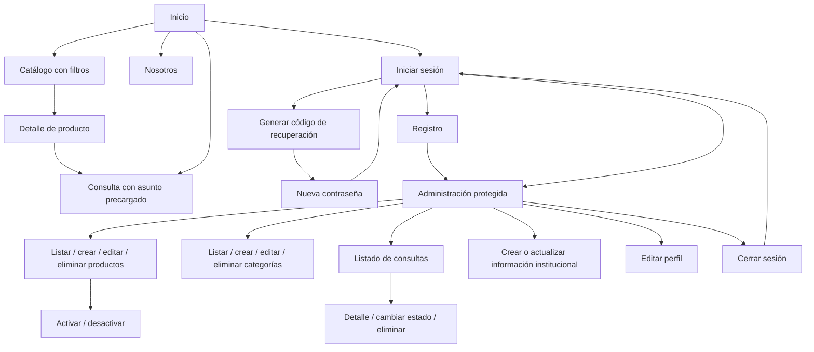
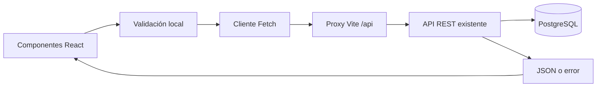

# Arquitectura y navegación

## Estructura

```text
src/
  main.jsx                    # React, Router y proveedor de sesión
  App.jsx                     # Rutas, foco, título y límite de errores
  components/
    Layouts.jsx               # Sitio público, administración y control de acceso
    UI.jsx                    # Formularios, errores, paginación, confirmaciones
    Dashboard.jsx             # Métricas, distribuciones y actualización manual
    ProductCard.jsx           # Tarjetas, disponibilidad e imágenes
    HardwareArt.jsx           # Ilustraciones vectoriales locales
  context/AuthContext.jsx     # Sesión y perfil autenticado
  lib/
    api.js                    # Fetch, timeout, token y errores en español
    dashboard.js              # Lectura paginada y agregación de métricas
    hooks.js                  # Carga cancelable y mutaciones sin doble envío
    validation.js             # Reglas reutilizables de los formularios
  pages/
    PublicPages.jsx           # Inicio, catálogo, detalle, nosotros, contacto
    AuthPages.jsx             # Registro, acceso y recuperación
    AdminPages.jsx            # Administración completa
  styles/
    global.css                # Bases, tipografía, foco y modo claro
    App.module.css            # Componentes y adaptaciones responsive
```

## Diagrama de navegación



## Flujo de datos



Los GET se cancelan cuando cambia la pantalla o los filtros para evitar respuestas antiguas. Las mutaciones deshabilitan controles durante el envío y bloquean solicitudes duplicadas. Los errores de negocio se traducen a mensajes en español; la validación local no reemplaza las restricciones de la API ni de PostgreSQL.

Los formularios tienen etiquetas, errores asociados, foco en el primer error y feedback de envío. La navegación incluye enlace para saltar al contenido y foco en el contenido al cambiar de ruta. El diálogo nativo de confirmación captura el foco y permite Escape cuando no hay una operación en curso. Se respeta la preferencia de reducir animaciones.

## Datos del dashboard

`Dashboard.jsx` carga las métricas al montarse y al pulsar Actualizar. `lib/dashboard.js` recorre `/admin/products` en páginas de 100, lee `/categories` y consulta `/inquiries?status=…&limit=1` para cada estado, aprovechando `meta.total` sin descargar todos los mensajes. Se usan solicitudes autenticadas con el cliente existente.

La visibilidad, la disponibilidad y la distribución por categoría se calculan sobre todos los productos. Se conservan las categorías sin productos. El desmontaje cancela las solicitudes y un error evita presentar resultados parciales. Si cambia el total de productos o aparecen duplicados durante la paginación, se solicita reintentar. No hay una instantánea transaccional entre endpoints ni actualización periódica. Las barras usan CSS y cantidades en texto, sin bibliotecas de gráficos.
