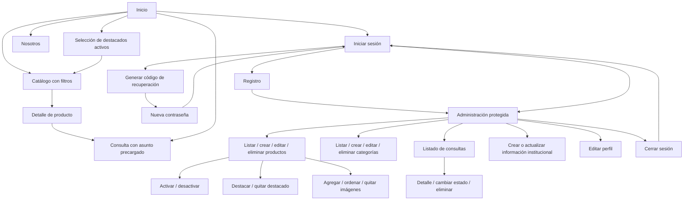
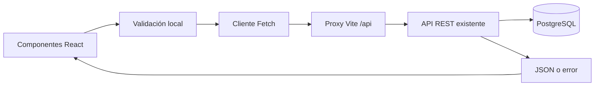

# Arquitectura y navegación

## Estructura

```text
src/
  main.jsx                    # React, Router y proveedor de sesión
  App.jsx                     # Rutas, foco, título y límite de errores
  components/
    Layouts.jsx               # Sitio público, administración y control de acceso
    UI.jsx                    # Formularios, errores, paginación, confirmaciones
    Dashboard.jsx             # Métricas, distribuciones y actualización manual
    FeaturedProducts.jsx      # Selección pública de destacados y estados de carga
    ProductCard.jsx           # Tarjetas, disponibilidad, destacado e imágenes
    ProductGallery.jsx        # Imagen principal, miniaturas y selección pública
    ProductImagesEditor.jsx   # URLs, vistas previas, orden y errores por imagen
    HardwareArt.jsx           # Ilustraciones vectoriales locales
  context/AuthContext.jsx     # Sesión y perfil autenticado
  lib/
    api.js                    # Fetch, timeout, token y errores en español
    dashboard.js              # Lectura paginada y agregación de métricas
    hooks.js                  # Carga cancelable y mutaciones sin doble envío
    validation.js             # Reglas reutilizables de los formularios
  pages/
    PublicPages.jsx           # Inicio, catálogo, detalle, nosotros, contacto
    AuthPages.jsx             # Registro, acceso y recuperación
    AdminPages.jsx            # Administración completa
  styles/
    global.css                # Bases, tipografía, foco y modo claro
    App.module.css            # Componentes y adaptaciones responsive
```

## Diagrama de navegación



## Flujo de datos



Los GET se cancelan cuando cambia la pantalla o los filtros para evitar respuestas antiguas. Las mutaciones deshabilitan controles durante el envío y bloquean solicitudes duplicadas. Los errores de negocio se traducen a mensajes en español; la validación local no reemplaza las restricciones de la API ni de PostgreSQL.

El catálogo conserva `minPrice` y `maxPrice` en la URL. Los importes se editan localmente y se aplican al enviar el formulario de precio; `validatePriceRange` controla formato, límites y relación entre ambos. Una URL con rango inválido muestra el error sin consultar productos. El backend admite esos parámetros en los listados público y administrativo y aplica condiciones SQL parametrizadas inclusivas antes de ordenar y paginar. No se requieren cambios de esquema ni dependencias.

Los formularios tienen etiquetas, errores asociados, foco en el primer error y feedback de envío. La navegación incluye enlace para saltar al contenido y foco en el contenido al cambiar de ruta. El diálogo nativo de confirmación captura el foco y permite Escape cuando no hay una operación en curso. Se respeta la preferencia de reducir animaciones.

Las reglas locales de correo, teléfono, URLs y precisión del precio están alineadas con los contratos del servidor. El backend reutiliza esquemas comunes para correo, teléfono y URLs; valida números JSON sin convertir nulos o booleanos. Las contraseñas nuevas se comprueban también por su longitud UTF-8 para impedir truncamiento. La confirmación de contraseña queda en la interfaz y las comprobaciones de unicidad, relaciones y autorización siguen en el servidor.

Al salir de un campo hacia el botón de envío, el formulario realiza la validación en el envío mismo para evitar que un mensaje nuevo desplace el botón antes de completar el clic. Se conservan las validaciones al salir hacia otros campos y la actualización de errores al escribir.

## Productos destacados

`FeaturedProducts.jsx` consulta `/products?isFeatured=true&limit=4&sort=newest` con el hook cancelable existente. El enlace de la sección conduce a `/productos?isFeatured=true`; el catálogo conserva el filtro al buscar, ordenar, paginar y recargar. La selección se publica como `isFeatured` y se presenta en tarjetas y detalle.

Los formularios y el interruptor administrativo envían booleanos JSON a los endpoints existentes de productos. PostgreSQL guarda `is_featured` con valor inicial `false`, agregado por la migración `006_add_featured_products.sql`. La API aplica conjuntamente el filtro de destacados y la condición de producto activo en las consultas públicas. La visibilidad y la selección se editan por separado; no hay selección automática ni dependencias nuevas.

## Galerías de productos

`ProductImagesEditor.jsx` integra la principal y las imágenes adicionales con el formulario: conserva nombres de campos propios para errores y foco, controla hasta diez URLs únicas y modifica el orden antes de guardar. Al enviar se forma `imageUrls`, un único arreglo ordenado; la primera entrada es la principal. Las URLs se recortan y validan antes del envío, y el servidor repite esas validaciones.

`ProductGallery.jsx` muestra la imagen seleccionada con `ProductImage`, miniaturas accesibles y contador. Las alternativas de carga se aplican por imagen. Una sola imagen no agrega controles de selección. No hay carrusel automático ni dependencia adicional.

La API mantiene `imageUrl` por compatibilidad y agrega `imageUrls` en listados y detalles. `product_images` guarda URL y posición por producto; la clave compuesta conserva posiciones únicas y la referencia al producto tiene eliminación en cascada. `products.image_url` mantiene la principal por compatibilidad y se actualiza en la misma transacción que la colección. Las ediciones bloquean la fila del producto para evitar colecciones mezcladas en escrituras simultáneas. La lectura usa una subconsulta agregada por producto, sin multiplicar filas ni alterar la paginación.

## Datos del dashboard

`Dashboard.jsx` carga las métricas al montarse y al pulsar Actualizar. `lib/dashboard.js` recorre `/admin/products` en páginas de 100, lee `/categories` y consulta `/inquiries?status=…&limit=1` para cada estado, aprovechando `meta.total` sin descargar todos los mensajes. Se usan solicitudes autenticadas con el cliente existente.

La visibilidad, la disponibilidad y la distribución por categoría se calculan sobre todos los productos. Se conservan las categorías sin productos. El desmontaje cancela las solicitudes y un error evita presentar resultados parciales. Si cambia el total de productos o aparecen duplicados durante la paginación, se solicita reintentar. No hay una instantánea transaccional entre endpoints ni actualización periódica. Las barras usan CSS y cantidades en texto, sin bibliotecas de gráficos.
